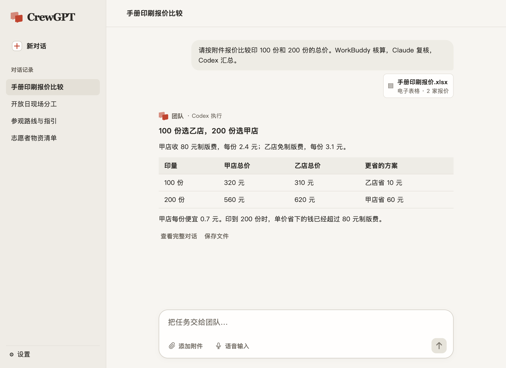
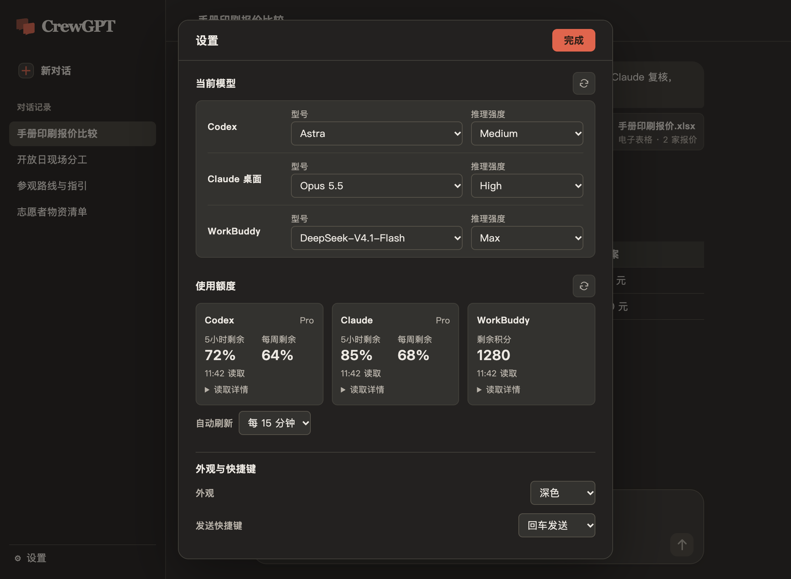

# CrewGPT

CrewGPT 是一款 macOS 多 AI 协作应用。把任务和资料发到一个对话里，就能让 Codex、Claude 和 WorkBuddy 一起工作。你可以看到谁说了什么、谁发来了文件，也可以直接打开最后的成果。

## 第一次怎么用

1. 打开「设置」，为要用的助手选择模型和推理强度。「使用额度」里可以查看 Codex 和 Claude 的 5 小时、每周剩余额度，以及 WorkBuddy 的剩余积分。具体选项以你的账号实际显示为准。
2. 点「新对话」，写下想要的成果。有资料就点「添加附件」，也可以从 Finder 复制文件，直接粘贴到输入框。用语音输入时，先看转写结果，改好再发送。
3. 在同一个对话里看答复、保存交付文件，或继续提出修改。点「查看完整对话」，可以按顺序读到各位助手的发言、核验意见和改稿，也能看到每个附件是谁发的。下次打开应用，任务还在左侧的对话记录里。

## 可以拿它做什么

比如，你手里有两份印刷报价。把 PDF 放进同一条消息，再交代一句：

> 我需要印 200 本。请比较两份报价，算上运费，告诉我哪份更划算。没有写清楚的费用，请列出来让我问商家。

看完建议，你还可以在原对话里补一句“如果改成 300 本呢？”，让团队沿用已有资料继续做。写研究简报时，也可以把草稿和数据表一起发进去，让团队核查数字、指出证据还不够的结论，再把中文改通顺。

## 一次真实协作：修改 CrewGPT 自己的项目介绍

最初那版项目介绍由 GPT 起草，DeepSeek 润色，最后由 GPT 定稿。初稿把 CrewGPT 写成“一个本地 macOS 团队聊天应用”。定稿改成了“一款在本机运行的 macOS 团队聊天应用”。只加了几个字，“本地”指的是什么就清楚了。

[看两处改稿的前后对照](examples/readme-polish/README.md)

## 我为什么做 CrewGPT

最近要写很多中文研究材料，我逐渐摸索出一套分工。

**在 WorkBuddy 里，我主要用 DeepSeek-V4.1-Flash 改中文。** 它便宜，中文也写得地道。有些句子语法没错，读着却别扭，交给它改就很合适。遇到复杂问题，我更信任 GPT 和 Claude。

**GPT 像个“顶级牛马”。** 只要我把要求说清楚，它就能把活干好。要求一模糊，让它自己摸索，它就常常跑偏。它交活慢，写中文也有一套自己的说法，我读着很费劲。它的英文我不了解，它写的中文材料我都会交给 DeepSeek 再改一遍。

查数据、核出处，是我最愿意交给 GPT 的活。它能访问我常用的大多数国内网站，遇到问题也最主动。碰到读不了的链接，它经常会自己换个办法继续查。同样的事，Claude 和 WorkBuddy 通常得我提醒。

**Claude 是我用下来觉得最聪明的，做复杂任务又快又好。** 它最大的短板是很多国内链接打不开。研究一旦用到中国的数据，就容易卡在找资料这一步。它写的中文，我也会交给 DeepSeek 润色。除此之外，我几乎挑不出什么缺点。封号问题这里不展开。按我的经验，用得当的话，日常开销也不高。

如果只说这三个模型各自最大的优缺点，我会这么说。

| 模型 | 我最看重的优点 | 我最在意的缺点 |
| --- | --- | --- |
| DeepSeek | 便宜，容易访问，中文地道。 | 遇到复杂问题，不够聪明。 |
| GPT | 作图水平高，尤其擅长 3D 图像。遇到问题，喜欢自己想办法解决。 | 写中文时常常“不说人话”。 |
| Claude | 速度快，干活强，三个里面最像人。 | 很多中文网站打不开，使用时也得格外小心。 |

三个模型配合，有时能写出单靠一个模型写不出的材料。麻烦的是，我成了中间传话的人。Claude 缺数据，我去找 GPT。GPT 查到出处，我再转给 Claude。稿子写完，还得贴给 DeepSeek。这样来回传，既费时间，也容易传错。我想让它们直接对话，自己只管交代任务、看结果。这就是我做 CrewGPT 的初衷。

**CrewGPT 还在早期。** 我先做出了自己写研究材料时最需要的功能。哪些任务值得让几位助手一起做，怎样让结果更好读、更方便核对，欢迎大家分享实际使用中的体会。
